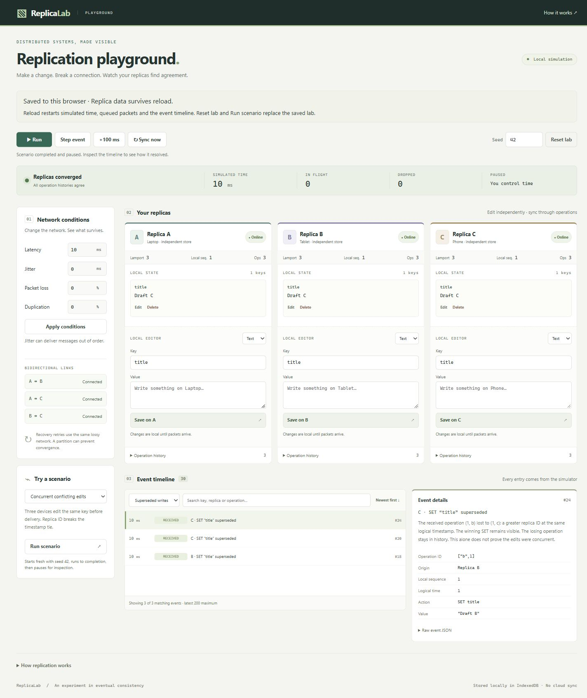
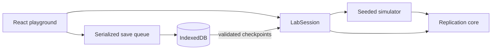

# ReplicaLab

**Make a change. Break a connection. Watch your replicas find agreement.**

ReplicaLab is a distributed key-value synchronisation engine and interactive playground for exploring offline-first data, network failures and deterministic conflict resolution. Three independent replicas exchange real operations through a seeded network simulator; the interface exposes the resulting state, history and delivery events.



**Status:** Milestones 0–4 are implemented; Milestone 5 is prepared locally with a manually gated demo workflow. No public demo, release tag or npm package has been published by this work. [Release guide](docs/releasing.md) · [Playground guide](docs/playground.md) · [Architecture](docs/architecture.md)

## Run locally

Install **Node.js 24** and **pnpm 11.25.0**, then:

```sh
git clone https://github.com/ethanclarke0705/ReplicaLab.git
cd ReplicaLab
pnpm install --frozen-lockfile
pnpm dev
```

Open the localhost URL printed by Vite. No environment variables, API keys, backend or account are needed. Use a current browser with JavaScript and IndexedDB. To serve the production build locally, run `pnpm build` followed by `pnpm preview`.

## Try an experiment

1. Disconnect replica C and save a new value there. The other replicas retain their own state.
2. Reconnect C, then run or step simulated time to deliver reconciliation packets.
3. Set packet loss to 100%, make another edit, and observe divergence. Restore delivery and advance time to recover.
4. Run **Concurrent conflicting edits** and filter the timeline to **Superseded writes**. Inspect the exact operation and tie-break that selected the winner.

Eight scenarios cover normal synchronisation, offline recovery, concurrent edits, delayed delivery, duplicates, reordering, deletion against a stale update and partition recovery. Scenarios execute to completion and pause for inspection; they are not prerecorded animations.

Wait for **Saved to this browser** before closing. Reload preserves identities, counters, clocks, full histories and network settings, then starts a fresh paused simulation. Queued packets and the event timeline restart. Reset lab and Run scenario replace the saved lab. Storage is local to the browser origin, with no cloud sync. See [persistence guarantees and limits](docs/persistence.md).

## What the engine demonstrates

| Mechanism                   | Behaviour                                                                                                 |
| --------------------------- | --------------------------------------------------------------------------------------------------------- |
| Operation-based replication | SET and DELETE records have an origin, local sequence and Lamport timestamp.                              |
| Deterministic resolution    | The greatest `(logicalTimestamp, replicaId)` wins, using raw UTF-16 replica-ID ordering.                  |
| Tombstones                  | Deleted keys retain winning DELETE records, so older writes cannot revive them.                           |
| Idempotent delivery         | Duplicate operations change neither state nor clock. Losing writes remain in history.                     |
| Anti-entropy                | Replicas exchange exact known-ID summaries, preserving gaps from reordered delivery.                      |
| Fault simulation            | Latency, jitter, loss, duplication, offline devices and link partitions affect real packets.              |
| Recovery                    | Periodic retries use the same lossy transport; successful exchange of all histories produces convergence. |

Last-writer-wins can discard concurrent updates from **visible state**. Logical time is not physical time, and a superseded write does not prove concurrency. Convergence is not guaranteed during permanent partitions or indefinite loss. [Read the synchronisation contract](docs/synchronisation.md).

## Architecture



- `packages/core`: browser-independent clocks, operations, replicas and validated checkpoints. No runtime dependencies.
- `packages/simulator`: deterministic scheduler, packet transport, recovery retries and scenarios, using public core APIs.
- `apps/playground`: React/Vite controls, inspection and native IndexedDB storage.
- `examples`: executable built-ESM examples with assertions.
- `scripts`: static-artifact verification and bounded repository hygiene checks.

See [architecture and trade-offs](docs/architecture.md), [network semantics](docs/simulator.md) and [the roadmap](docs/roadmap.md).

## Use the core

From a workspace package depending on `@replicalab/core`:

```ts
import { Replica } from '@replicalab/core';

const laptop = new Replica('laptop');
const phone = new Replica('phone');
laptop.set('title', 'Laptop draft');
phone.set('title', 'Phone draft');

for (const op of laptop.missingOperations(phone.knownOperationIds())) {
  phone.receive(op);
}
for (const op of phone.missingOperations(laptop.knownOperationIds())) {
  laptop.receive(op);
}
// Both show "Phone draft": equal logical timestamps, then replica-ID ordering.
```

`state()` returns visible values, `winner(key)` includes tombstones, and `history()` retains all operations. `Replica.restore(replica.checkpoint())` restores identity and counters without replaying clock events. Packages remain private workspace packages; they are not published to npm.

## Verify and explore

| Command              | Purpose                                                                                           |
| -------------------- | ------------------------------------------------------------------------------------------------- |
| `pnpm check`         | Formatting, lint, strict types, tests, builds and static demo verification                        |
| `pnpm release:check` | All checks, tracked/history signature scan, local documentation links and all executable examples |
| `pnpm test:watch`    | Interactive Vitest development                                                                    |
| `pnpm demo`          | [Offline reconciliation](examples/reconciliation.mjs)                                             |
| `pnpm demo:network`  | [Eight fault scenarios](examples/network-scenarios.mjs)                                           |
| `pnpm demo:restore`  | [Checkpoint recovery and counter continuation](examples/restoration.mjs)                          |
| `pnpm audit`         | Current dependency advisories; requires registry access                                           |

Tests include seeded fast-check properties, simulator integration, storage transactions, UI flows and deployment-artifact checks. CI is configured for Node 24 on Linux and Windows. Local and hosted verification and their limits are recorded in [the release review](docs/release-review.md).

## Deployable demo

`apps/playground/dist/` is the complete static output. Relative asset URLs support both a domain root and a project subpath. The [Pages workflow](.github/workflows/pages.yml) is **manual only** and defaults to building an artifact without deployment. Publishing requires a separate explicit `publish: true` run on `main` and repository Pages configuration. It does not deploy on push or pull request. [Setup, validation and rollback instructions](docs/releasing.md).

## Limits and project scope

ReplicaLab is an educational, inspectable implementation, not a production database. Histories and tombstones are unbounded; reconciliation exchanges full ID lists and storage writes complete checkpoints. Browser data can be cleared or evicted. Identities belong to one isolated lab; tabs do not collaborate. There is no real networking, authentication, causal-conflict detection, CRDT, compaction or backup service. Safe-integer exhaustion fails explicitly.

Contributions should preserve the protocol's invariants and deterministic tests. See [CONTRIBUTING](CONTRIBUTING.md), [SECURITY](SECURITY.md) and [release notes](CHANGELOG.md).

## License

[MIT](LICENSE).
