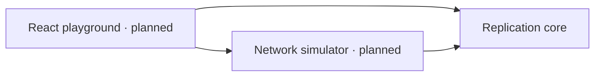

# ReplicaLab

An open-source distributed data synchronisation engine and planned interactive playground for exploring offline-first systems, network failures and conflict resolution.

Independent devices can edit the same data while disconnected. Reconciliation must tolerate duplicates, delays and different delivery orders. ReplicaLab makes those rules explicit and testable, starting with a headless TypeScript engine.

## Status

Milestone 0 establishes the workspace, strict TypeScript, linting, formatting, tests and CI. The replication engine is next. No simulator, browser application or persistence is implemented yet.

## Development

Install Node.js 24 and pnpm 11.25.0, then run:

```sh
pnpm install --frozen-lockfile
pnpm check
pnpm test:watch
```

`pnpm check` runs formatting, linting, type checking, tests and package builds. Individual commands are `pnpm format:check`, `pnpm lint`, `pnpm typecheck`, `pnpm test` and `pnpm build`. Run `pnpm format` to format changes. Generated ESM and declarations go into each package's ignored `dist/` folder.

## Architecture



- `packages/core`: transport-independent operation and replica logic.
- `packages/simulator`: planned deterministic scheduler and simulated transport.
- `apps/playground`: planned React/Vite interface.

See [architecture](docs/architecture.md), [synchronisation](docs/synchronisation.md), [roadmap](docs/roadmap.md) and [contributing](CONTRIBUTING.md).

## License

[MIT](LICENSE).
