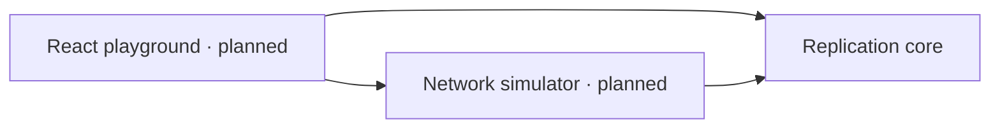

# ReplicaLab

An open-source distributed data synchronisation engine and planned interactive playground for exploring offline-first systems, network failures and conflict resolution.

Independent devices can edit the same data while disconnected. Reconciliation must tolerate duplicates, delays and different delivery orders. ReplicaLab makes those rules explicit and testable, starting with a headless TypeScript engine.

## Status

Milestones 0 and 1 are implemented: a pnpm workspace and a tested, headless replication engine. No simulator, browser application or persistence is implemented yet.

- Independent replicas with SET and DELETE operations over JSON values.
- Lamport clocks and deterministic last-writer-wins resolution.
- Tombstones, duplicate suppression and retained operation history.
- Explicit missing-operation exchange, including gaps in received history.
- Runtime validation, immutable records and seeded property-based tests.

Last-writer-wins can discard concurrent updates from visible state. Convergence requires successful exchange of all operations; it is not promised during partitions or indefinite message loss.

## Development

Install Node.js 24 and pnpm 11.25.0, then run:

```sh
pnpm install --frozen-lockfile
pnpm check
pnpm test:watch
pnpm demo
```

`pnpm check` runs formatting, linting, type checking, tests and package builds. Individual commands are `pnpm format:check`, `pnpm lint`, `pnpm typecheck`, `pnpm test` and `pnpm build`. Run `pnpm format` to format changes. Generated ESM and declarations go into each package's ignored `dist/` folder.

## Try the engine

`pnpm demo` builds the core and runs [an executable offline-edit example](examples/reconciliation.mjs) with assertions. From another workspace package, depend on `@replicalab/core` using `workspace:*` and import its public API:

```ts
import { Replica } from '@replicalab/core';

const laptop = new Replica('laptop');
const phone = new Replica('phone');
laptop.set('title', 'Laptop draft');
phone.set('title', 'Phone draft');

// The transport delivers records; the core owns their application.
for (const operation of laptop.missingOperations(phone.knownOperationIds())) {
  phone.receive(operation);
}
for (const operation of phone.missingOperations(laptop.knownOperationIds())) {
  laptop.receive(operation);
}
// Both show "Phone draft": equal logical timestamps, then replica-ID ordering.
```

Use `get(key)` or `state()` for visible values, `winner(key)` for the winning operation (including tombstones), and `history(key?)` to inspect every accepted operation. Receiving an operation reports `applied`, `superseded` or `duplicate`.

## Architecture



- `packages/core`: transport-independent operation and replica logic.
- `packages/simulator`: planned deterministic scheduler and simulated transport.
- `apps/playground`: planned React/Vite interface.

See [architecture](docs/architecture.md), [synchronisation](docs/synchronisation.md), [roadmap](docs/roadmap.md) and [contributing](CONTRIBUTING.md).

## Current limitations

State is memory-only. Replica IDs must be unique and must not be reused after losing state. Full history is retained without compaction, and reconciliation exchanges exact ID lists. The engine does not authenticate peers, detect causal concurrency, schedule retries or provide a transport. Numeric clocks stop with an error at JavaScript's safe-integer limit. See the design documents for detailed contracts and costs.

Next is Milestone 2: a deterministic network simulator with latency, partitions, packet faults and reconciliation retries. React/Vite and IndexedDB follow in later milestones.

## License

[MIT](LICENSE).
