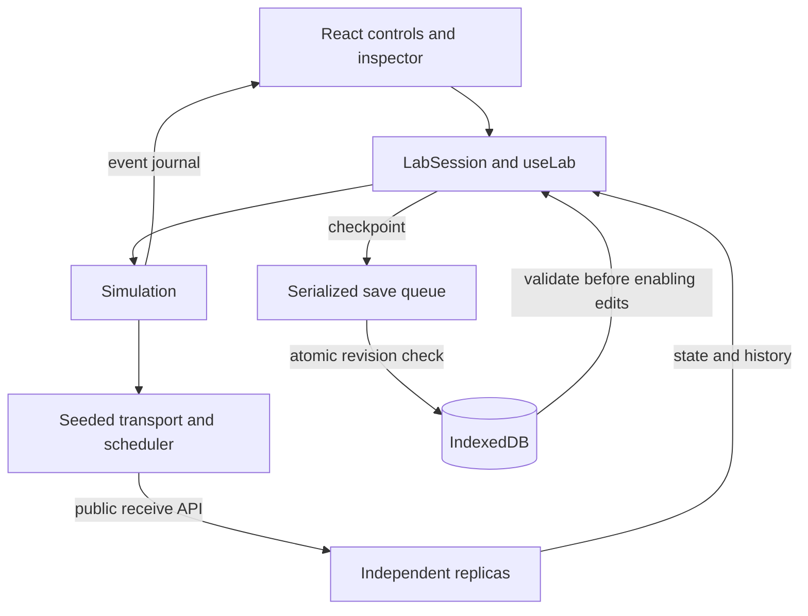
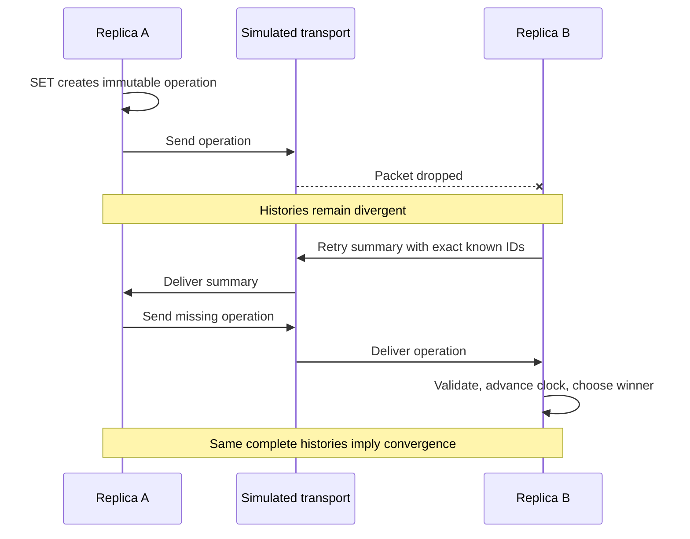

# Architecture

## Dependency boundaries

The core owns replica state, logical time, operation history and deterministic resolution. It exports ESM and TypeScript declarations, with no runtime dependencies. Tests run in Node without a browser.

Implemented modules are `clock.ts` (safe Lamport arithmetic), `value.ts` (JSON validation and immutable copies), `operation.ts` (wire records and ordering), and `replica.ts` (state, history and exchange primitives). `index.ts` defines the public API. The core targets ES2022 and uses no DOM types or Node APIs. `examples/reconciliation.mjs` verifies the built ESM in Node.

Each replica owns private maps of known operations and winning operations. Incoming records are validated before any mutation. Values and operations are deeply immutable; visible maps are detached snapshots. No hidden singleton state, timers or shared mutable replica state are used.

The simulator owns delivery, scheduling, seedable randomness, network links and retries. `Transport` delivers immutable packets to registered handlers without holding replicas. `Simulation` adapts the structural `ReplicaEndpoint` interface to this transport; it exchanges summaries and operations through public core APIs. Within the simulator package, only the scenario factory constructs concrete replicas. The React/Vite playground constructs a session or uses that factory, displaying real state and events from those layers.

`Scheduler` orders events by simulated deadline and insertion ID; `SeededRandom` drives fault choices. A single scheduler serves packet delivery and reconciliation retries, giving deterministic ordering across both. `EventJournal` exposes detached event-array snapshots. Details and correctness limits are in [the simulator contract](simulator.md).

Start with full operation history and explicit known-ID exchange. This is easy to inspect and supports gaps caused by out-of-order delivery. A maximum sequence number alone is not sufficient to identify missing operations. Compaction and transport optimisation are deferred until they have a proven protocol.

The UI depends on React, React DOM and the two workspace packages. Its `LabSession` adapter owns the replicas and simulation; `useLab` issues public commands and publishes detached snapshots to React. Browser timers only advance simulated time and are cleaned up on pause or unmount. Neither engine package depends on React, browser types or timers. `PersistentPlayground` loads and validates IndexedDB checkpoints before mounting the interactive app. A serialized save queue coalesces pending snapshots, and atomic revision checks reject stale writers. The adapter uses native IndexedDB; fake-indexeddb is a test-only dependency. See the [playground guide](playground.md) and [persistence contract](persistence.md).

Development type checking and Vitest resolve workspace source through the `development` package-export condition. Library builds disable that condition and use compiled exports, building core before simulator through the workspace dependency graph. Vite also resolves the source condition and bundles the real engine and simulator into the browser application. This avoids testing stale build output while keeping the built library ESM independently runnable. The simulator's only runtime dependency is the workspace core.

TypeScript is pinned to 6.0.3: typescript-eslint 8.72.1 supports TypeScript below 6.1 and rejects TypeScript 7. Upgrade the compiler when the lint toolchain supports it. pnpm is pinned to the installed 11.25.0 version for reproducible local and CI installs.

## Trade-offs

| Choice                            | Benefit                                             | Limit                                                                     |
| --------------------------------- | --------------------------------------------------- | ------------------------------------------------------------------------- |
| Lamport LWW                       | Small deterministic resolver with explicit ordering | Does not retain concurrent values in visible state or establish causality |
| Exact known-ID summaries          | Correct with holes and reordered delivery           | Full histories and summaries grow without compaction                      |
| Simulated clock and seeded faults | Repeatable tests and inspectable scenarios          | Does not model real sockets, bandwidth or wall-clock scheduling           |
| Full atomic lab checkpoint        | Consistent origins, counters and history on reload  | Rewrites the checkpoint; not intended for large datasets                  |
| Revision-checked storage          | Stale tabs cannot overwrite newer durable state     | Conflict requires reload; no collaborative multi-tab merge                |
| Relative static assets            | Same artifact works at root or project subpath      | Requires static HTTP hosting and correct trailing-slash URLs              |

## Delivery and recovery

This sequence assumes those later packets succeed. Retry traffic itself can be lost. No direct state-copy path bypasses the transport.
