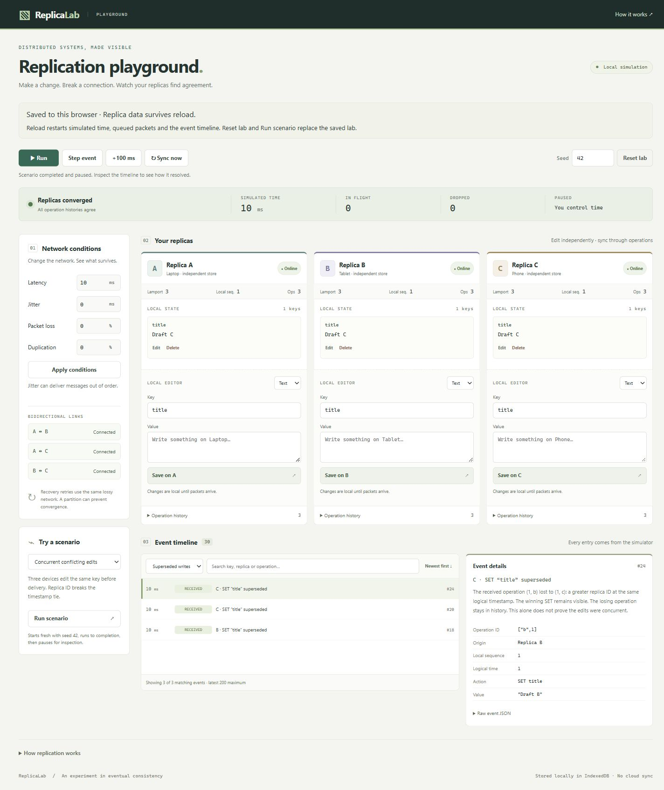

# Playground

The playground provides a responsive React/Vite interface over the real replication engine and deterministic simulator. Milestone 4 adds IndexedDB persistence without a backend or real network connection. Run `pnpm dev` from the repository root; `pnpm build` followed by `pnpm preview` serves the production bundle locally. These usually use different ports and therefore have separate browser storage.

## Controls

- Each of A, B and C owns an independent replica. Save text or JSON, edit existing keys, or delete a key. Deletion produces a real tombstone, inspectable alongside retained operation history. Invalid JSON is reported without creating an operation.
- Disconnect a device to edit it offline. Reconnect it and advance time to let the simulator exchange missing operations. Link buttons partition individual bidirectional connections; a remaining route through the third device may still allow recovery.
- Apply latency, jitter, packet-loss and duplication settings to future packet sends. Jitter can reorder delivery. Recovery summaries and responses use the same lossy transport as edits; permanent isolation or 100% loss can prevent convergence.
- Run advances simulated time by 100 ms per browser timer tick. Pause stops that timer; Step event executes the next scheduled task, while +100 ms advances a fixed interval. Browser throttling can slow playback relative to wall-clock time. Sync now requests reconciliation but does not deliver queued packets immediately.
- Reset lab creates a fresh session using the entered seed and replaces the saved lab. The default seed is 42, latency is 200 ms and the retry interval is 500 ms. The initial shared value has already been delivered at simulated time 200 ms.
- Run scenario creates a fresh session with the active seed, executes the selected real scenario to completion, and pauses for inspection. It does not animate a prerecorded script. The eight scenarios cover normal sync, offline recovery, concurrent edits, delays, duplication, reordering, stale updates against deletion, and partition recovery. Scenario-specific network settings replace the previous controls.

## Inspecting results

The status bar reads actual history convergence, simulated time, pending packets and dropped packets. Convergence means all replicas have the same complete operation history, not merely matching visible values. Packets can remain in flight after convergence, and Lamport clocks can differ.

Filter and search the event timeline, change its ordering, then select an event for operation metadata, raw JSON and a plain-language explanation. A superseded write remains in history. The inspector distinguishes a higher logical timestamp from the replica-ID tie-break; superseded status alone does not establish causal concurrency.

The timeline renders at most 200 matching events at once. Automatic playback pauses after observing at least 15,000 journal events; a tick may exceed that threshold. Manual commands remain available. These are UI responsiveness measures, not history compaction: event and operation histories remain in memory and can keep growing. Reset to discard a large session.

## Implementation and verification

`session.ts` owns concrete replicas and `Simulation`, validates editor input and exposes detached snapshots. `useLab.ts` owns the session lifecycle, command errors and playback timer. Components render snapshots and call public commands; none assigns a desired convergence outcome or implements a second conflict resolver. Scenario results come from `runScenario` in the simulator package.

The interface provides labelled controls, semantic regions, a skip link, visible keyboard focus, status feedback and responsive layouts. Automated tests exercise offline recovery, deletion, invalid JSON, packet-loss recovery, playback cleanup, scenario reset and conflict inspection using the real engine. `pnpm check` passed all 100 tests plus formatting, linting, both TypeScript configurations and production builds at Milestone 3 completion.

Browser verification covered desktop (1440 px), mobile (390 px, no horizontal overflow), production-bundle offline edit/reconnection and the concurrent-write inspector. No browser warning or error was recorded during the verified production flow. This is focused browser verification, not a comprehensive accessibility audit.

## Saving and reloading

The storage banner distinguishes saving, saved and failed states. Wait for “Saved to this browser” before closing. Reload restores replica identities, clocks, counters, full histories, network conditions, connectivity and the seed, with playback paused. Operation history survives; the event timeline, pending packets and simulated clock start fresh at zero. Recovery retries resume when you advance time, at the default 500 ms interval.

Storage failures pause editing and playback. Retry saving after resolving the storage error; unsaved changes remain in memory. A conflicting save from another tab requires reloading the newer lab and discarding this tab's unsaved changes. Unreadable or unsupported checkpoints are not automatically replaced. Startup offers a retry or a temporary session that leaves saved data untouched.

Production-browser verification for Milestone 4 confirmed an offline edit and tombstone across reload, continuing sequence numbers, reconnection convergence, and a second reload retaining the converged histories. The storage banner was also checked at 390 px with no horizontal overflow. See the [persistence contract](persistence.md) for storage scope, validation and failure limits.

Milestone 5 refreshed the screenshots and verified the production artifact under `/ReplicaLab/`, including the conflict inspector and reload restoration. The [mobile controls screenshot](images/playground-mobile.jpg) shows the network and scenario panels at 390 px. Deployment remains a separate authorized action; see the [release guide](releasing.md).
